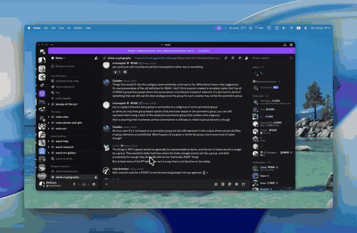

# LangLens

<p align="center">
  
  
  
</p>

A menu-bar loupe for macOS. Frame any on-screen text, translate it, and leave the translation sitting on top of the original — same place, same size, under glass.

<p align="center">
  
</p>

The app lives in the menu bar. There is no Dock icon.

Current UI is Russian. Target languages include English, Russian, Chinese, Japanese, Korean, German, French, Spanish, Portuguese, Italian, Thai, and Georgian.

## Install

macOS 14 or later.

1. Download `LangLens-*-macos.zip` from [Releases](https://github.com/mtglitch/magic-loupe/releases/latest).
2. Unzip and drag **LangLens** into `/Applications`, or open it in place.
3. If Gatekeeper blocks it, right-click the app → **Open** → **Open**. A double-click is not enough until macOS has seen that confirmation once.

Unsigned or ad-hoc builds are expected until a Developer ID + notarization pass is wired up. After that, the same zip opens like any other Mac app.

From source, after installing Xcode or the Command Line Tools:

```bash
make run
```

That compiles a debug build and opens `~/Applications/LangLens.app`.

## First launch

1. Grant **Screen Recording** when the permission wall asks. macOS will offer **Quit & Reopen**; after that the wall comes back with a checkmark and you can continue.
2. Open settings from the loupe or the menu-bar item (right-click → **Настройки**).
3. Paste an [OpenRouter](https://openrouter.ai) API key and press **Сохранить**. The key is written to Keychain, not to a file.
4. Pick a model. The default is `google/gemini-2.5-flash`.

Left-click the menu-bar item to show the loupe. Right-click for Translate, Settings, Restart, and Quit.

## How it works

1. Place the frame over the text. Drag the chrome to move; pull the edges or the bottom-right chamfer to resize.
2. Press **Перевести**, or use automatic mode and let it fire when the picture under the frame actually changes.
3. The overlay fades out, a still of that rectangle is captured, Vision reads the blocks, OpenRouter translates them.
4. Glass chips land on the original words. While the model is thinking, a diagonal gleam runs across the empty frame.

**Lock on** — clicks stay in the loupe, the translation is selectable, right-click copies it. **Lock off** — clicks pass through to the window underneath.

Esc (or the close control) hides the loupe. It does not quit the app.

## Privacy

LangLens is a screen-reading tool. The honest version of what that means:

| What | Where it goes |
| --- | --- |
| Capture | Only the rectangle inside the frame, into memory, for that translation. |
| Disk | Screenshots are not written. Nothing in the capture path saves a PNG or JPEG. |
| Audio | Not used. The Info.plist string exists because Screen Recording on macOS is bundled with audio capture permission. |
| Key | OpenRouter API key lives in Keychain (`com.mtglitch.MagicLoupe`). |
| Prefs | Model, language, lock, and translate mode go to `UserDefaults`. |
| Network | OCR text is sent to OpenRouter (`https://openrouter.ai/api/v1/chat/completions`). That is a third party. Do not frame secrets you would not paste into a translator. |

There is no account, no telemetry, no update ping.

## Build

Swift 6, AppKit, Swift Package Manager. No Xcode project.

```bash
make build      # debug .app → ~/Applications/LangLens.app
make run        # build and open
make release    # optimized .app, same install path
```

Bundle identifier: `com.mtglitch.MagicLoupe`.

Signing is ad-hoc unless `CODESIGN_IDENTITY` is set, or a single **Developer ID Application** identity is in the keychain when you cut a release.

## Releasing

One script bumps the version, builds a universal zip, and can publish a GitHub Release.

```bash
./scripts/release.sh 0.2.0              # dist/LangLens-0.2.0-macos.zip
./scripts/release.sh 0.2.0 --github     # commit, tag v0.2.0, push, gh release
./scripts/release.sh --dry-run
```

`make dist VERSION=0.2.0` and `make github-release VERSION=0.2.0` are the same entry points.

| Variable | Role |
| --- | --- |
| `CODESIGN_IDENTITY` | `Developer ID Application: Name (TEAMID)`. If unset, release signing uses the only Developer ID in the keychain, or ad-hoc. |
| `NOTARY_PROFILE` | `xcrun notarytool` keychain profile. When set, the zip is notarized and stapled before it is published. |
| `SWIFT_ARCHES` | Defaults to `arm64 x86_64`. Set `arm64` if the universal build is not worth it. |

Release notes are taken from the matching `##` section in `CHANGELOG.md`. Marketing version is `CFBundleShortVersionString`; each published cut increments `CFBundleVersion`.

`--github` refuses to run if anything other than `Resources/Info.plist` is dirty, and it will not create the GitHub repository for you.

If the public repo URL is not `https://github.com/mtglitch/magic-loupe`, update the `HTTP-Referer` in `OpenRouterClient.swift` so OpenRouter rankings point at this project.

## License

[MIT](LICENSE)
